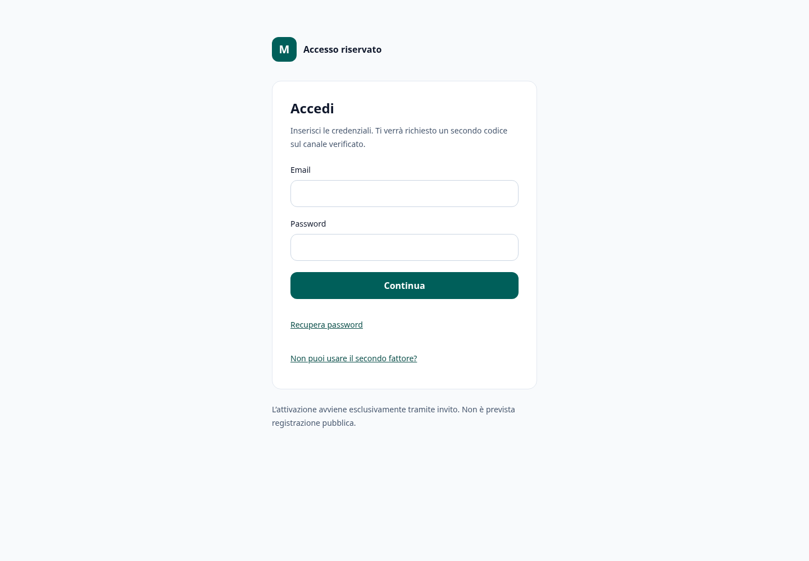
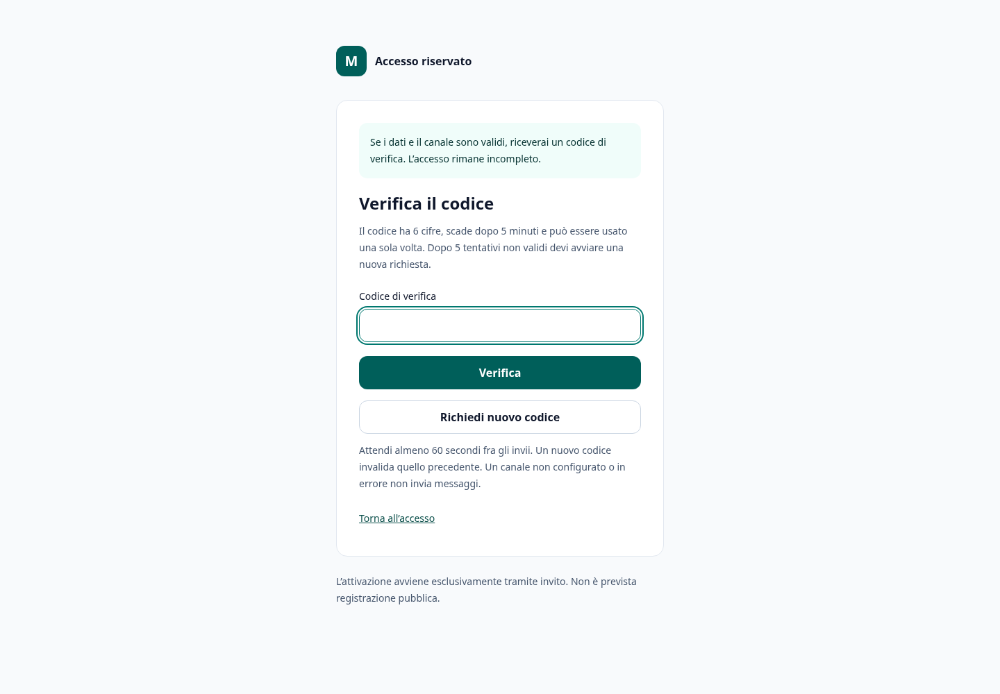
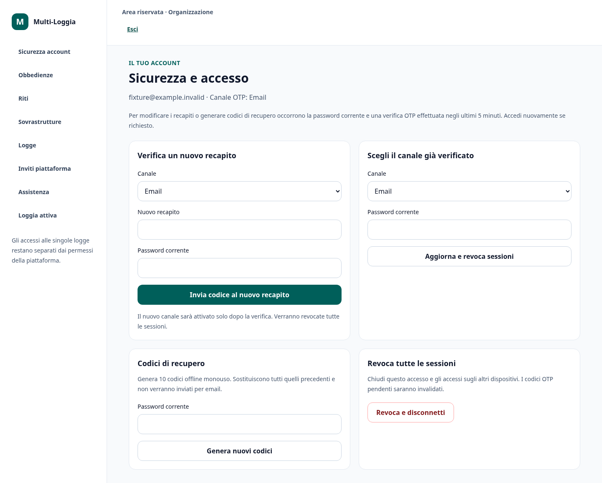
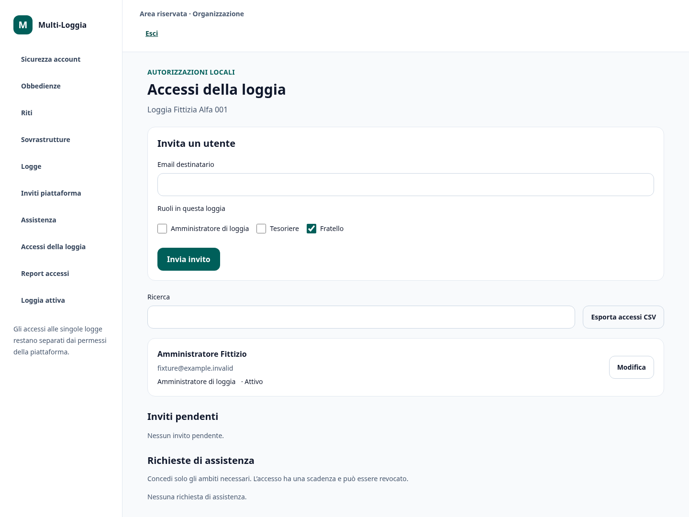
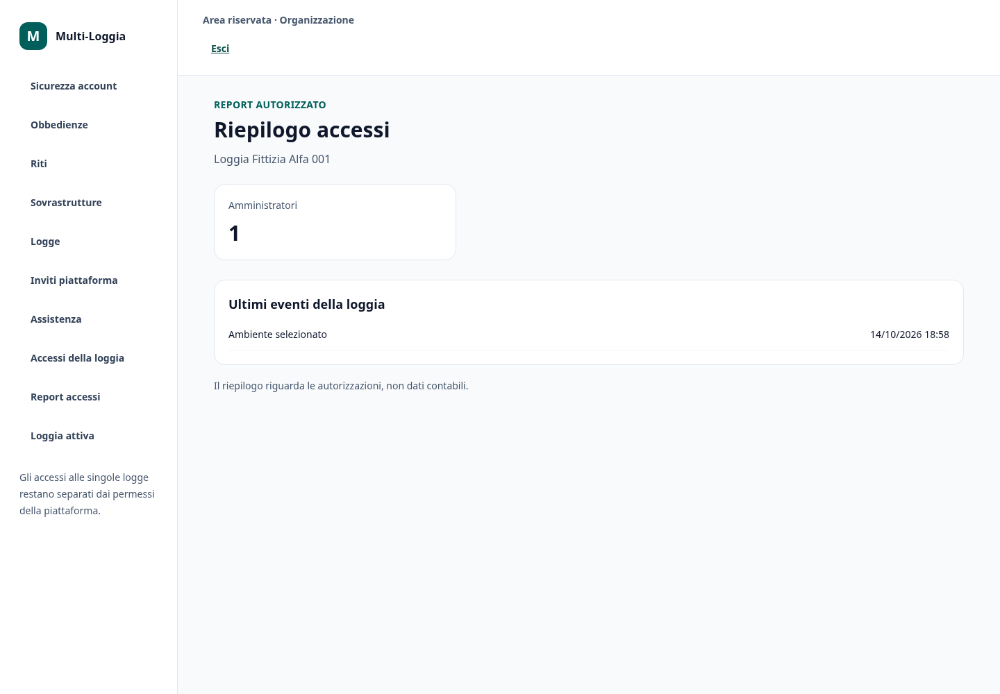
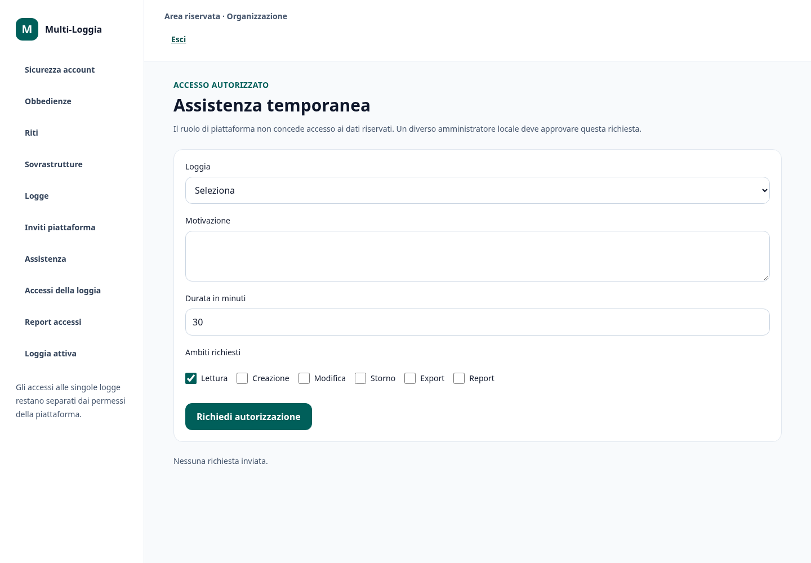
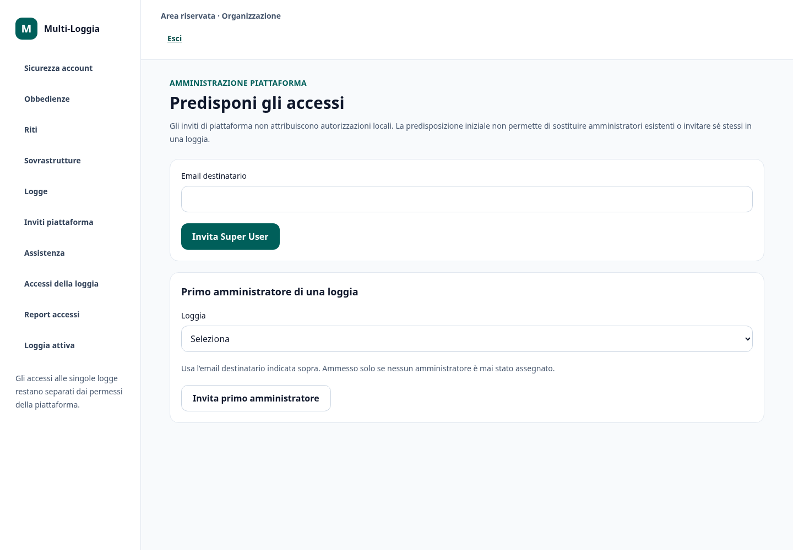
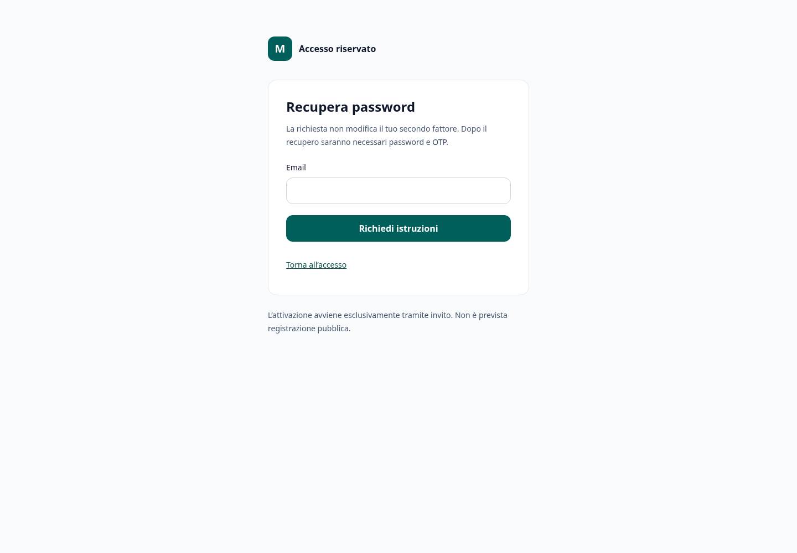
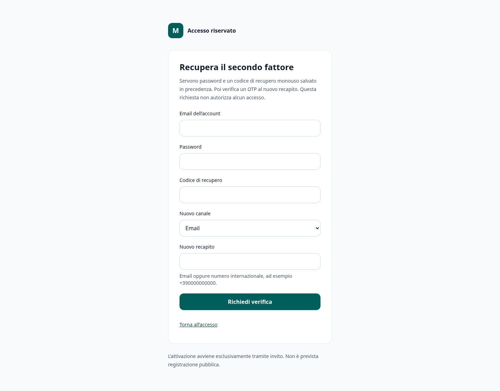

# Schermate fase 2

Acquisite con login reale password e OTP SMTP locale di test. Solo account, indirizzi e strutture completamente fittizi; nessun OTP o codice offline esposto. Desktop 1440×1000 e mobile 320×740.

## Login

[Desktop](login-desktop.png) · [Mobile](login-mobile.png)

## Otp

[Desktop](otp-desktop.png) · [Mobile](otp-mobile.png)

## Sicurezza

[Desktop](sicurezza-desktop.png) · [Mobile](sicurezza-mobile.png)

## Accessi

[Desktop](accessi-desktop.png) · [Mobile](accessi-mobile.png)

## Report accessi

[Desktop](report-accessi-desktop.png) · [Mobile](report-accessi-mobile.png)

## Assistenza

[Desktop](assistenza-desktop.png) · [Mobile](assistenza-mobile.png)

## Inviti piattaforma

[Desktop](inviti-piattaforma-desktop.png) · [Mobile](inviti-piattaforma-mobile.png)

## Recupero password

[Desktop](recupero-password-desktop.png) · [Mobile](recupero-password-mobile.png)

## Recupero fattore

[Desktop](recupero-fattore-desktop.png) · [Mobile](recupero-fattore-mobile.png)

