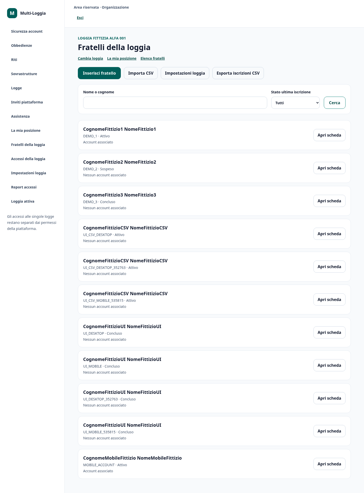
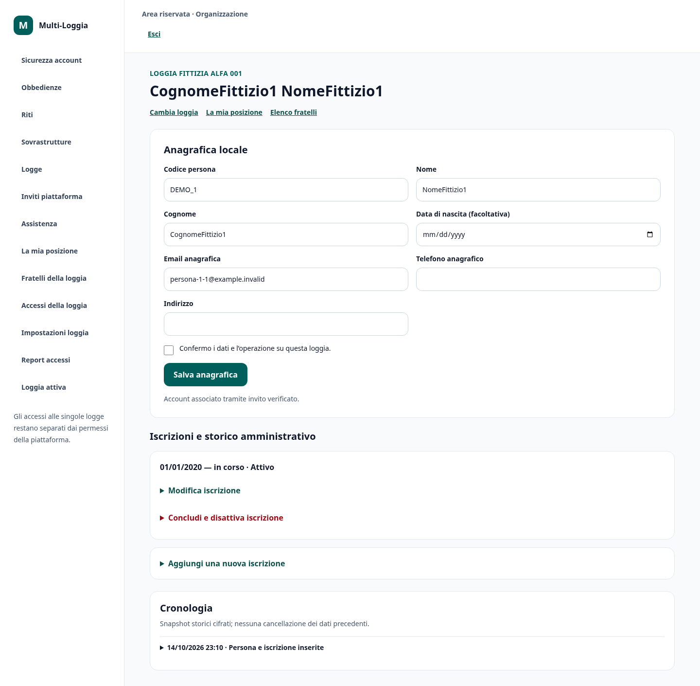
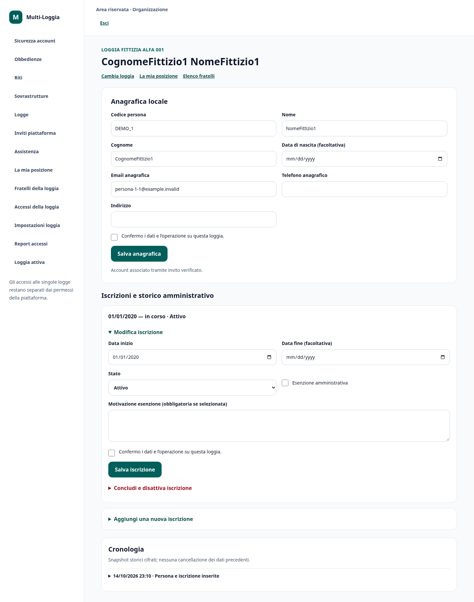
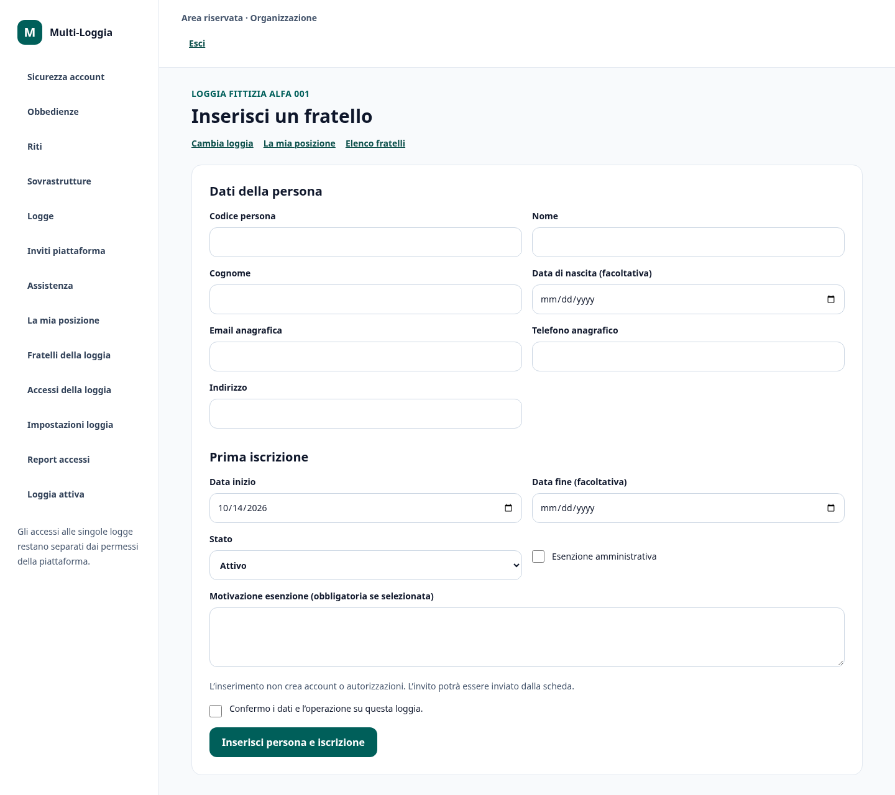
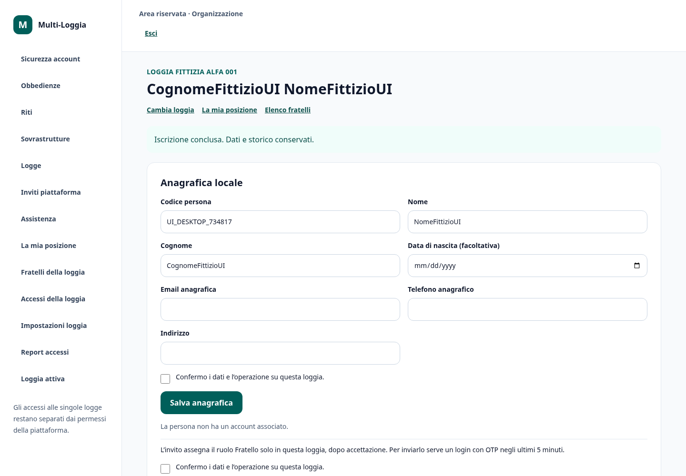
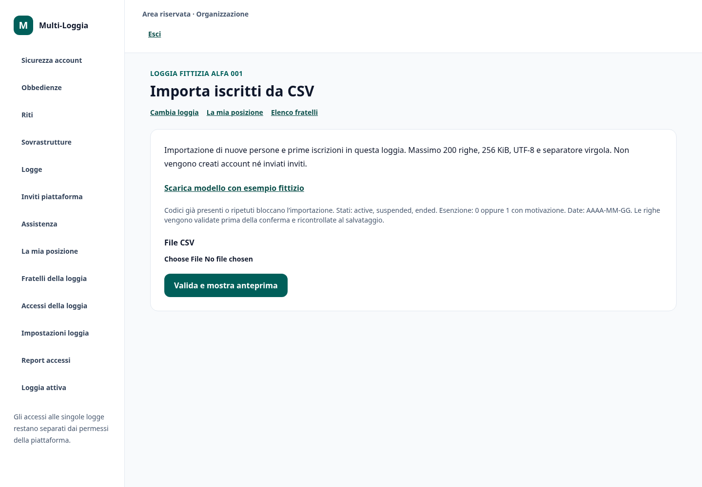
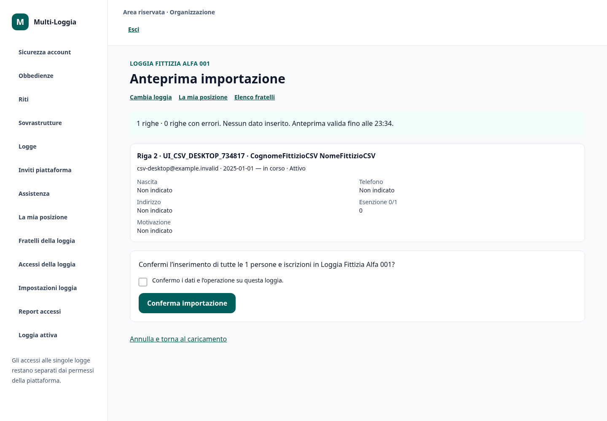
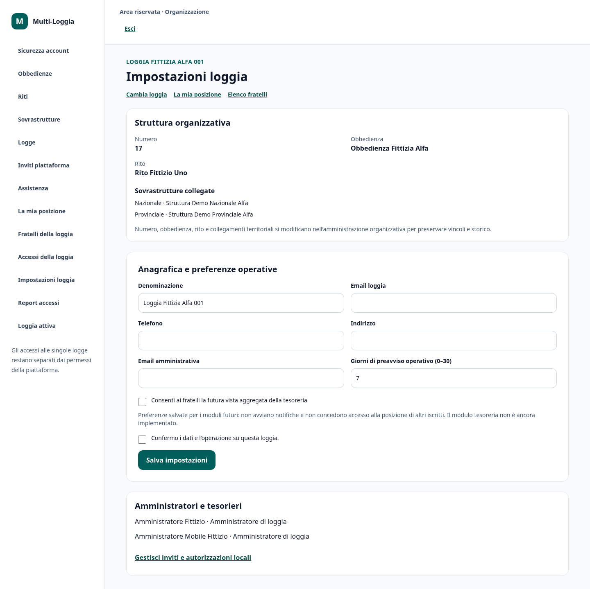
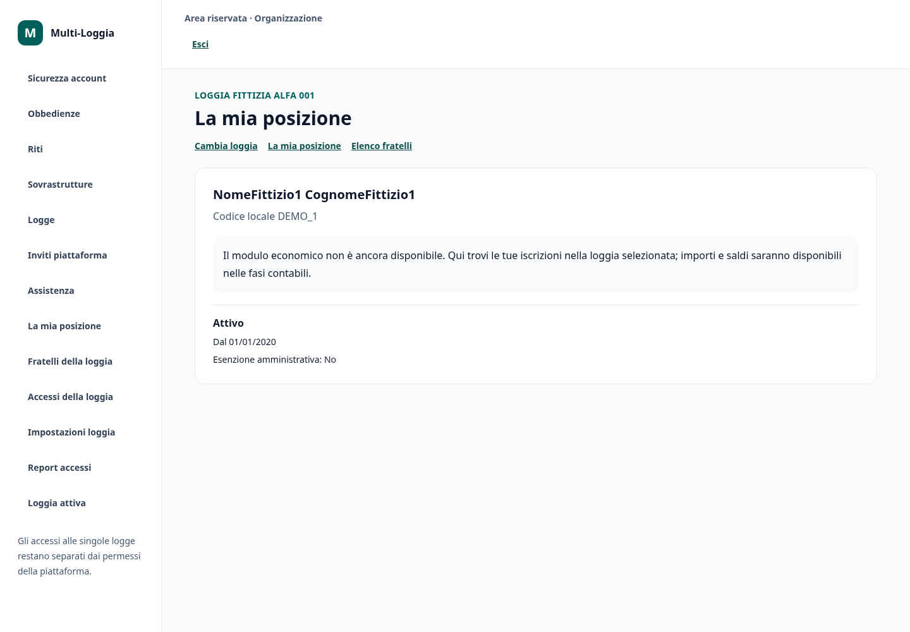

# Schermate fase 3

Solo dati completamente fittizi; login reale password + OTP ricevuto dal server SMTP locale di test. Desktop 1440×1000 e mobile 320×740. Nessun OTP/token invito visibile.

## Elenco

[Desktop](elenco-desktop.png) · [Mobile](elenco-mobile.png)

## Scheda

[Desktop](scheda-desktop.png) · [Mobile](scheda-mobile.png)

## Modifica iscrizione

[Desktop](modifica-iscrizione-desktop.png) · [Mobile](modifica-iscrizione-mobile.png)

## Inserimento

[Desktop](inserimento-desktop.png) · [Mobile](inserimento-mobile.png)

## Iscrizione conclusa

[Desktop](iscrizione-conclusa-desktop.png) · [Mobile](iscrizione-conclusa-mobile.png)

## Importazione

[Desktop](importazione-desktop.png) · [Mobile](importazione-mobile.png)

## Anteprima csv

[Desktop](anteprima-csv-desktop.png) · [Mobile](anteprima-csv-mobile.png)

## Impostazioni

[Desktop](impostazioni-desktop.png) · [Mobile](impostazioni-mobile.png)

## Posizione personale

[Desktop](posizione-personale-desktop.png) · [Mobile](posizione-personale-mobile.png)

